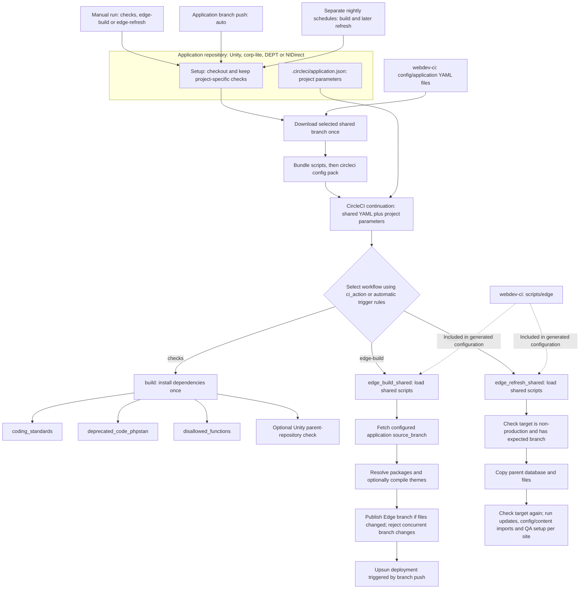

# New shared CI flow

All application projects use the same jobs and workflows. A project supplies
settings for its versions, code paths, sites and Edge behaviour.

The build and refresh remain separate scheduled workflows. There is no waiting
job between them and no check that a particular commit has finished deploying.
The refresh job stays running while its remote commands finish.

The setup starts in manual-only mode (`ci_action=none`). Trigger an explicit
action to test it. Later, set the setup default to `auto` for branch checks and
configure PR triggers in CircleCI. Each schedule must pass its action explicitly;
schedule names do not select workflows.

## Testing from CORP-855

Set `shared_ci_ref` to `CORP-855` in the setup template or pipeline trigger.
Its default is `main`. Setup downloads that branch once and includes its scripts
in the generated YAML. Jobs unpack the bundle without downloading shared code.

Keep these branch choices separate:

| Choice | What it supplies |
| --- | --- |
| Application pipeline branch | The project's setup file and checkout |
| Shared CI branch, `shared_ci_ref` | Shared YAML and scripts; `CORP-855` during the trial |
| `source_branch` | Application code used to build Edge |

Publishing changes to the shared branch does not switch existing legacy
projects. Each project must first adopt the new setup. Repository validation
jobs check both configurations separately; they do not run these Edge workflows.

See [getting started](getting-started.md) for local checks and the
[application reference](application-ci.md) for project settings.
