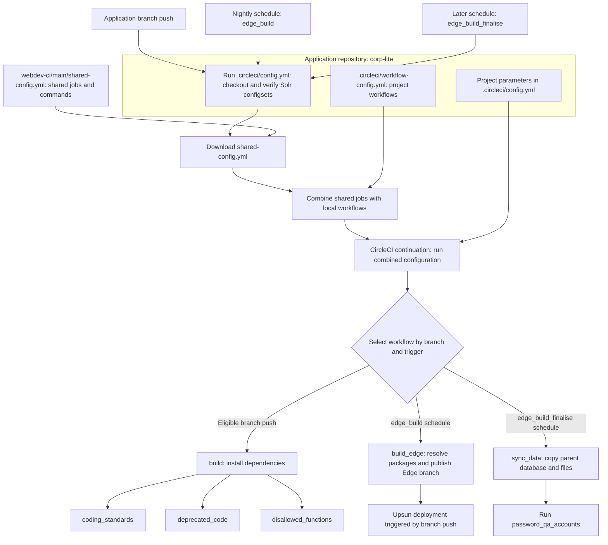

# Legacy CI flow

This shows the existing corp-lite setup. Each application keeps its own workflow
file and combines it with jobs downloaded from `webdev-ci/main`.

The nightly build and data refresh are independent. The gap between their
schedules allows time for deployment; the refresh does not wait for the build.

Unity uses separate `unity_edge_build` and `unity_sync_data` jobs in the same
shared file. These include theme building and per-site refresh work, which is
why the legacy jobs differ between projects.

The diagram focuses on normal checks and nightly runs. The inspected corp-lite
workflow also has a separate API-only `manual-edge-build` route on `DEPT-edge`,
where `sync_data` depends on `build_edge`. That dependency does not apply to the
nightly schedules. Branch-push checks are not inherently PR-only; CircleCI's
project trigger settings also determine when pipelines start.

See the [legacy guide](legacy-ci.md) for the setup example.
